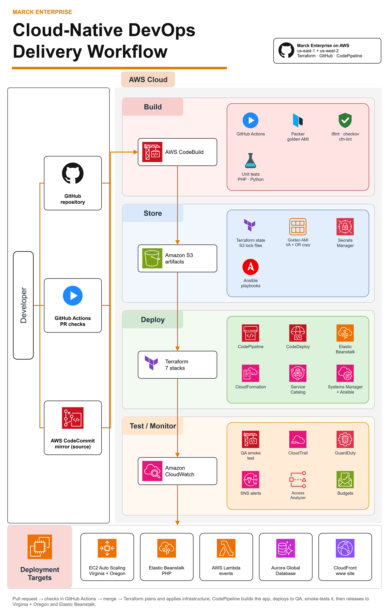

# AWS Projects

AWS portfolio for cloud and DevOps engineering roles. This repository is where I publish the infrastructure and automation that show how I design, secure, and operate workloads on Amazon Web Services.

## Projects

| Project | What it is |
| --- | --- |
| [Marck Enterprise](marck-enterprise-project) | A two-region AWS platform delivered entirely as code: Terraform stacks, GitHub Actions with OIDC, CodePipeline releases through QA to production, Aurora Global Database, and ten AWS case studies combined into one system |

## What this work shows

- Network design across Availability Zones, with public and private subnets and controlled outbound access
- Identity and access with least-privilege IAM, MFA for operators, and GitHub OIDC for the pipelines
- Infrastructure as code in Terraform, with remote state and a reviewable plan before apply
- Continuous delivery that promotes one build through QA to production in two regions
- Separate development, test, and production environments

Each project lives in its own folder so it can be reviewed on its own. Shared GitHub settings (workflows, code owners, Dependabot) sit in `.github/` at the repository root, with workflow names prefixed by project.
