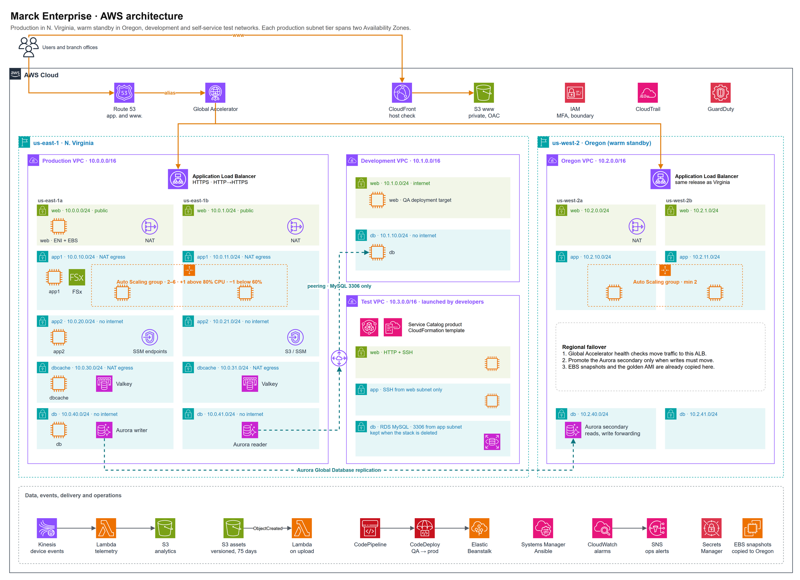

<div align="center">

# Marck Enterprise on AWS

**A two-region AWS platform built and delivered entirely as code.**

[](https://github.com/marcka-devops/aws-projects/actions/workflows/marck-enterprise-ci.yml)
[](https://github.com/marcka-devops/aws-projects/actions/workflows/marck-enterprise-terraform.yml)


[](LICENSE)

[Architecture](#architecture) · [What it demonstrates](#what-it-demonstrates) · [Quick start](#quick-start) · [Case studies](docs/case-studies.md) · [Docs](docs/)

</div>

---

Marck Enterprise is a fictional company with branch offices across the country. Its platform serves a branch-reporting web app from two AWS regions, collects device telemetry in near real time, hosts the company website, and lets developers spin up their own test environments.

The project brings ten AWS case studies (networking, IAM, compute, storage, databases, delivery and configuration management) together into **one working system**, built the way a platform team would run it: every change goes through a pull request, CI checks it, Terraform plans it for review, and releases reach production only after passing QA.


## What it demonstrates

| Practice | How it is done here |
| --- | --- |
| **Infrastructure as code** | Terraform in seven stacks with separate state, three reusable modules, consistent file layout ([ADR 0001](docs/adr/0001-terraform-stacks.md)) |
| **Keyless CI/CD** | GitHub Actions assumes AWS roles through OIDC. Plans are read-only; applies need approval in a protected environment ([ADR 0002](docs/adr/0002-github-oidc.md)) |
| **Shift-left checks** | Every pull request runs `terraform validate`, TFLint, Checkov, cfn-lint, ansible-lint, ShellCheck, PHP and Python tests |
| **Progressive delivery** | CodePipeline builds once, deploys to QA, smoke-tests it, then releases to two regions one instance at a time with automatic rollback |
| **Immutable images** | Packer builds the web server AMI and copies it to the second region |
| **Configuration as code** | Ansible playbooks applied by Systems Manager State Manager; drift is corrected daily ([ADR 0003](docs/adr/0003-ansible-instead-of-opsworks.md)) |
| **Self-service** | Developers launch three-tier test environments from Service Catalog without admin rights |
| **Security by default** | Least-privilege IAM, MFA enforcement, permissions boundary, private tiers, encryption everywhere, CloudTrail, GuardDuty ([SECURITY.md](SECURITY.md)) |
| **Resilience** | Multi-AZ tiers, Aurora Global Database, Global Accelerator across regions, cross-region snapshots |
| **Operability** | Alarms to SNS, a cost budget, [runbooks](docs/runbooks.md), [cost and teardown guide](docs/cost-and-teardown.md) |

## Architecture



| Layer | Design |
| --- | --- |
| **Edge** | `app.<domain>` → Route 53 → Global Accelerator → ALB in us-east-1 or us-west-2. `www.<domain>` → CloudFront → private S3 bucket; any other host gets the error page |
| **Compute** | Auto Scaling groups of 2–6 instances per region; +1 instance above 80% CPU, −1 below 60%. Shared files on FSx for OpenZFS |
| **Network** | Production VPC with five tiers across two AZs (`web` public, `app1` and `dbcache` via NAT, `app2` and `db` isolated). Development VPC peered to production for MySQL between the db tiers only |
| **Data** | Aurora MySQL Global Database (Virginia writer and reader, Oregon reader with write forwarding, 2-day backups), Valkey cache, Kinesis → Lambda analytics |
| **Delivery** | GitHub → CodeCommit mirror → CodePipeline: Build → QA → smoke test → Production (both regions) → Elastic Beanstalk |
| **Operations** | Systems Manager (Session Manager, State Manager with Ansible), CloudWatch alarms, SNS, CloudTrail, GuardDuty, Access Analyzer, Budgets |

Both diagrams are editable: open [`docs/architecture/marck-enterprise.drawio`](docs/architecture/marck-enterprise.drawio) in [draw.io](https://app.diagrams.net), then run `make diagrams` to refresh the PNGs.

## Tech stack

| Area | Tools |
| --- | --- |
| Cloud | AWS: VPC, EC2, Auto Scaling, ALB, Global Accelerator, Route 53, CloudFront, S3, Aurora, ElastiCache, Kinesis, Lambda, FSx, IAM, KMS, Secrets Manager, Systems Manager, Service Catalog, CloudFormation, CodeCommit, CodeBuild, CodeDeploy, CodePipeline, Elastic Beanstalk, CloudWatch, CloudTrail, GuardDuty |
| Infrastructure as code | Terraform, CloudFormation, Packer |
| CI/CD | GitHub Actions, AWS CodePipeline |
| Configuration | Ansible, AWS Systems Manager |
| Quality and security | TFLint, Checkov, cfn-lint, ansible-lint, ShellCheck, pre-commit, Dependabot |
| Application | PHP 8, Python 3.13 |

## Repository structure

```
aws-projects/
├── .github/                      Repository root: GitHub only runs workflows from here
│   ├── workflows/                marck-enterprise-ci · -terraform · -codecommit-mirror · -packer
│   ├── ISSUE_TEMPLATE/           Bug and improvement forms
│   └── CODEOWNERS · dependabot.yml · pull_request_template.md
└── marck-enterprise-project/     This project
    ├── app/                      PHP branch portal, CodeDeploy hooks, buildspecs, tests
    ├── config/ansible/           Playbooks applied by Systems Manager
    ├── docs/
    │   ├── architecture/         draw.io source + PNG exports
    │   ├── adr/                  Architecture decision records
    │   ├── getting-started.md
    │   ├── case-studies.md       Every case-study task → code → how to check it
    │   ├── runbooks.md
    │   └── cost-and-teardown.md
    ├── functions/                Lambda functions and unit tests
    ├── infra/
    │   ├── modules/              vpc · nacl · web_fleet
    │   ├── stacks/               00-bootstrap → 70-self-service (apply in order)
    │   └── cloudformation/       Developer test-stack template
    ├── packer/                   Golden AMI
    ├── website/                  Static site for www.<domain>
    ├── Makefile                  make help
    └── CHANGELOG.md · CONTRIBUTING.md · SECURITY.md · LICENSE
```

See [infra/README.md](infra/README.md) for what each stack creates and the feature toggles.

## Quick start

```bash
git clone https://github.com/marcka-devops/aws-projects.git
cd aws-projects/marck-enterprise-project

# 1. One-time bootstrap: state bucket + GitHub OIDC roles
terraform -chdir=infra/stacks/00-bootstrap init
terraform -chdir=infra/stacks/00-bootstrap apply -var github_owner=<your-github-user>

# 2. Settings: state bucket, domain, your IP, GitHub user
cp infra/settings.env.example infra/settings.env

# 3. Apply every stack in order
make apply-all
```

Then connect GitHub so pull requests plan and merges apply. The full walkthrough is in [docs/getting-started.md](docs/getting-started.md).

> **Cost:** the defaults run about **$1.40 an hour** (≈ $1,000 a month), mostly Aurora. Deploy, demo, then tear down. See [cost and teardown](docs/cost-and-teardown.md) for cheaper settings.

## Case studies

| # | Case study | Built in |
| --- | --- | --- |
| 1 | EC2, EBS, EFS | `50-compute`, `packer/` |
| 2 | IAM | `20-security` |
| 3 | ELB, Auto Scaling, Route 53 | `modules/web_fleet`, `50-compute` |
| 4 | VPC and peering | `10-network`, `50-compute` |
| 5 | S3 versioning and website hosting | `40-storage`, `website/` |
| 6 | Database architecture | `30-data` |
| 7 | Multi-tier architecture | `infra/cloudformation/`, `70-self-service` |
| 8 | Automation and configuration management | `60-delivery`, `40-storage`, `config/ansible/` |
| 9 | FSx, Global Accelerator, ENI | `50-compute` |
| 10 | AWS DevOps (CI/CD) | `60-delivery`, [`.github/workflows/`](../.github/workflows) |

Task-by-task mapping with verification commands: [docs/case-studies.md](docs/case-studies.md).

## Contributing

See [CONTRIBUTING.md](CONTRIBUTING.md) for the branch, commit and review workflow.

## Author

**Marck Altidor**, DevOps Engineer and Cloud Architect. [GitHub @marcka-devops](https://github.com/marcka-devops)

Released under the [MIT License](LICENSE).
